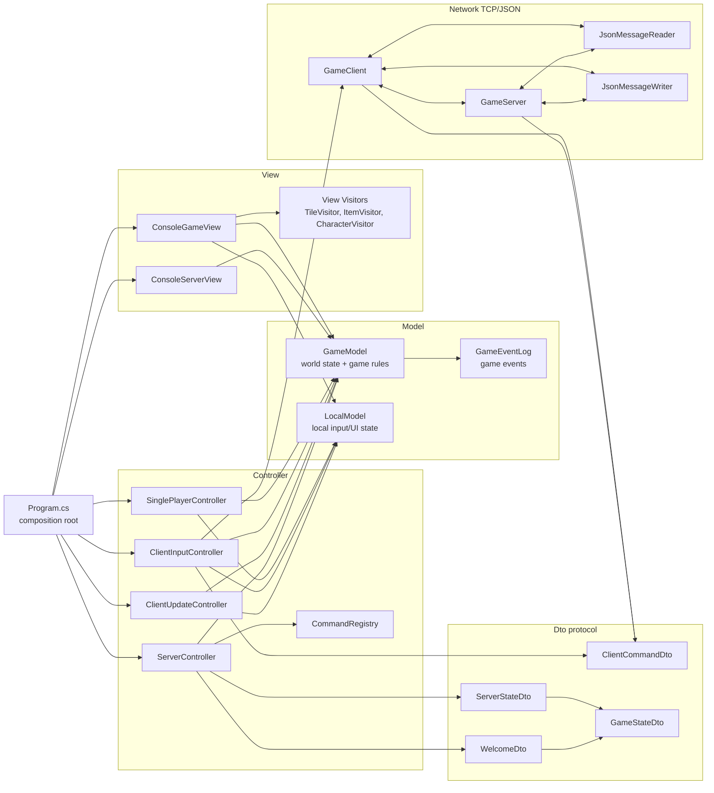
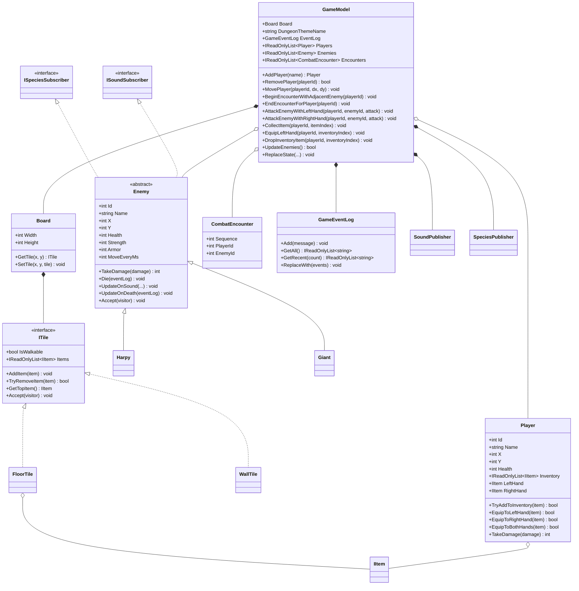
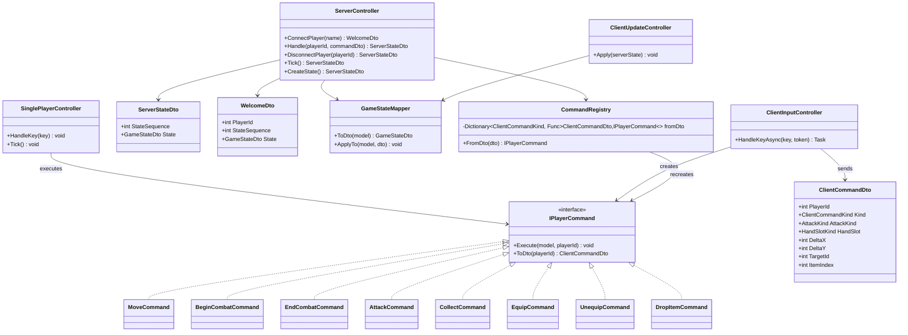
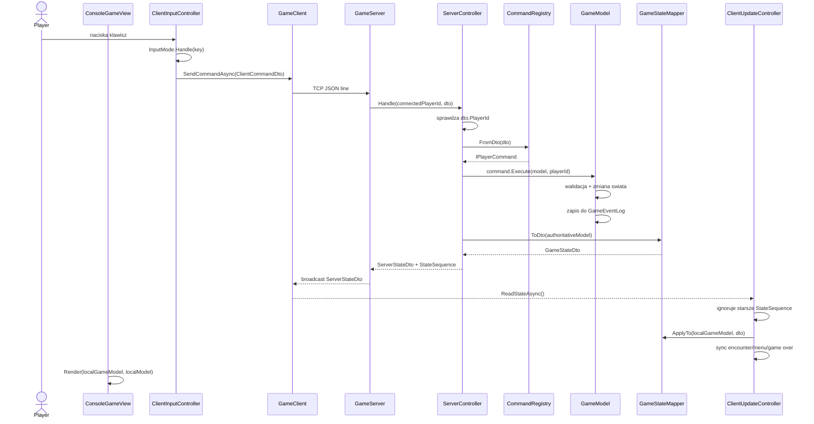
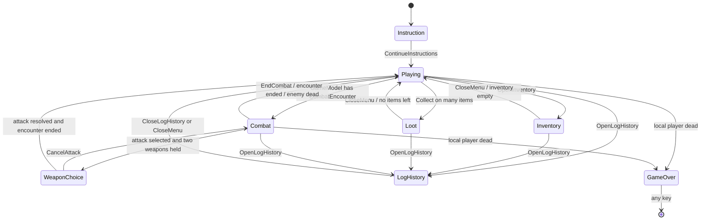
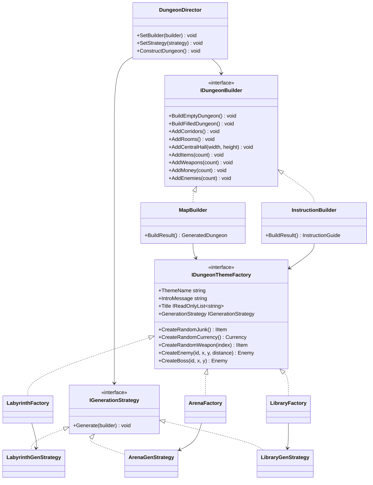
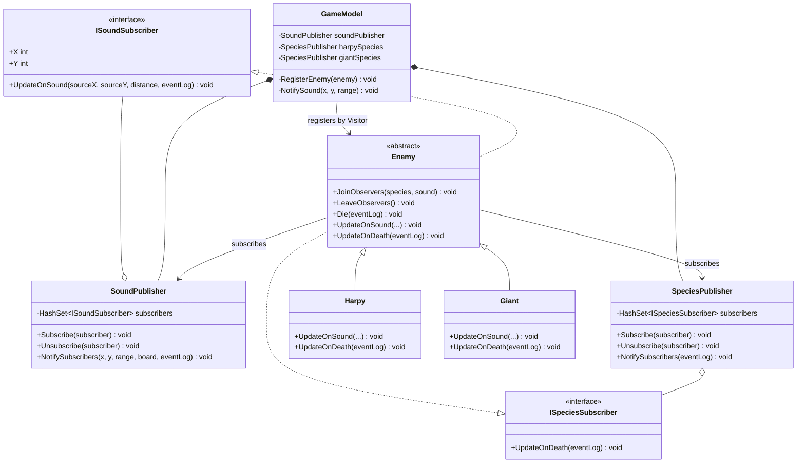
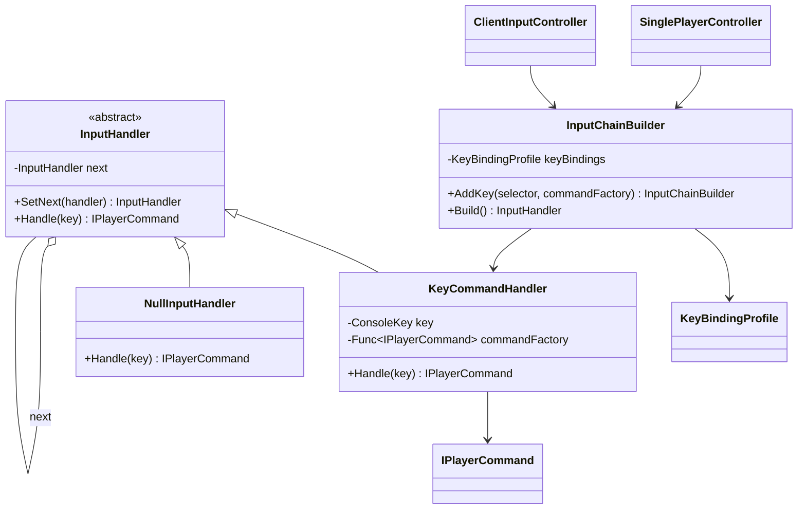

# UML diagrams - RpgGame MVC, stage 6

Ten dokument pokazuje najwazniejsze zaleznosci w projekcie po refaktoryzacji do MVC oraz po dodaniu multiplayera TCP/JSON.
Diagramy sa zapisane w formacie Mermaid, wiec mozna je wyrenderowac np. w VS Code, GitHub Markdown albo mermaid.live.

## 1. Diagram komponentow MVC i multiplayer

Ten diagram pokazuje glowny podzial odpowiedzialnosci:

- `GameModel` jest source of truth dla swiata gry.
- `LocalModel` trzyma tylko lokalny stan UI/inputu konkretnego gracza.
- `View` renderuje stan, ale go nie zmienia.
- Kontrolery inicjuja akcje.
- W multiplayerze klient wysyla DTO, a serwer wykonuje komendy na autorytatywnym `GameModel`.

## 2. Diagram klas - glowny Model gry

Ten diagram pokazuje rdzen domeny. Najwazniejsze jest to, ze reguly gry sa w `GameModel`: ruch, kolizja ze sciana, rozpoczecie i zakonczenie walki, smierc przeciwnika, loot, ekwipunek i reakcje przeciwnikow.

## 3. Diagram klas - komendy, kontrolery i protokol DTO

Ten diagram pokazuje, jak wejscie gracza jest zamieniane na komendy. W singleplayerze komenda wykonuje sie na lokalnym `GameModel`. W multiplayerze klient wysyla `ClientCommandDto`, a serwer odtwarza komendy przez `CommandRegistry`.

## 4. Diagram sekwencji - akcja gracza w multiplayer

Przyklad: gracz naciska klawisz ruchu, zbierania itemu albo ataku. Klient nie zmienia swiata bezposrednio. Wysyla DTO do serwera, a serwer waliduje i modyfikuje autorytatywny model.

## 5. Diagram stanow lokalnego inputu

`LocalModel` posiada stos `IInputMode`. To jest lokalny stan klienta/gracza, a nie stan swiata. Dzieki temu singleplayer i multiplayer moga miec ten sam `GameModel` i ten sam `ConsoleGameView`.

## 6. Diagram klas - generowanie mapy: Builder + Strategy + Factory

Ten diagram pokazuje wzorce z etapu 2/4 przeniesione do Modelu. `DungeonDirector` steruje budowaniem, `IGenerationStrategy` okresla kolejnosc krokow, a `IDungeonThemeFactory` dostarcza konkretne itemy, przeciwnikow, tytul i intro dla motywu.

## 7. Diagram klas - itemy: Decorator + Visitor + walka

Ten diagram pokazuje itemy i walke. Modyfikatory itemow sa dekoratorami, a ataki sa Visitorami. Dzieki temu mapowanie DTO i walka nie wymagaja RTTI.

```mermaid
classDiagram
    class IItem {
        <<interface>>
        +Name string
        +Bonuses PlayerStats
        +SoundRange int
        +PickUp(player) bool
        +EquipToLeftHand(player, instance) bool
        +EquipToRightHand(player, instance) bool
        +Unequip(player) void
        +AcceptAttack(visitor, player) CombatStats
        +Accept(visitor) void
    }

    class Weapon {
        <<abstract>>
        +Damage int
        +GetFullDamage(player) int
    }

    class HeavyWeapon
    class LightWeapon
    class MagicWeapon
    class Kopis
    class Labrys
    class Xiphos
    class StymphalianQuill
    class Dory

    class Currency
    class Gold
    class Coin
    class JunkItem
    class OldBook
    class AriadnesThread
    class CyclopsEye
    class IcarusFeather
    class ShatteredShield

    class ItemDecorator {
        <<abstract>>
        -IItem decorated
        +InnerItem IItem
    }

    class SpartanModifier
    class AthenianModifier
    class HephaesteanModifier
    class MidasTouchModifier
    class PrometheanModifier
    class AchillesBaneModifier
    class AphroditesKissModifier
    class DionysianModifier
    class HydrasVenomModifier
    class IcarianModifier

    class IAttackVisitor {
        <<interface>>
        +Name string
        +Visit(HeavyWeapon, player) CombatStats
        +Visit(LightWeapon, player) CombatStats
        +Visit(MagicWeapon, player) CombatStats
        +Visit(IItem, player) CombatStats
    }

    class NormalAttack
    class StealthAttack
    class MagicAttack

    IItem <|.. Weapon
    Weapon <|-- HeavyWeapon
    Weapon <|-- LightWeapon
    Weapon <|-- MagicWeapon
    HeavyWeapon <|-- Kopis
    HeavyWeapon <|-- Labrys
    LightWeapon <|-- Xiphos
    LightWeapon <|-- StymphalianQuill
    MagicWeapon <|-- Dory

    IItem <|.. Currency
    Currency <|-- Gold
    Currency <|-- Coin
    IItem <|.. JunkItem
    JunkItem <|-- OldBook
    JunkItem <|-- AriadnesThread
    JunkItem <|-- CyclopsEye
    JunkItem <|-- IcarusFeather
    JunkItem <|-- ShatteredShield

    IItem <|.. ItemDecorator
    ItemDecorator o-- IItem : wraps
    ItemDecorator <|-- SpartanModifier
    ItemDecorator <|-- AthenianModifier
    ItemDecorator <|-- HephaesteanModifier
    ItemDecorator <|-- MidasTouchModifier
    ItemDecorator <|-- PrometheanModifier
    ItemDecorator <|-- AchillesBaneModifier
    ItemDecorator <|-- AphroditesKissModifier
    ItemDecorator <|-- DionysianModifier
    ItemDecorator <|-- HydrasVenomModifier
    ItemDecorator <|-- IcarianModifier

    IAttackVisitor <|.. NormalAttack
    IAttackVisitor <|.. StealthAttack
    IAttackVisitor <|.. MagicAttack
    IItem --> IAttackVisitor : AcceptAttack
```

## 8. Diagram klas - Observer przeciwnikow bez C# event

W projekcie nie uzywa sie C# `event`. Przeciwnicy subskrybuja publisherow jawnie. Reakcje sa zapisywane do `GameEventLog`, a nie bezposrednio do konsoli.

## 9. Diagram klas - Chain of Responsibility dla inputu

Ten diagram pokazuje wzorzec z etapu 2. Kontrolery nie maja duzych switchy po klawiszach dla kazdej komendy ruchu/ekwipunku/walki, tylko buduja lancuch handlerow.

